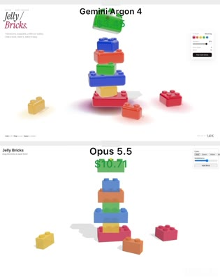
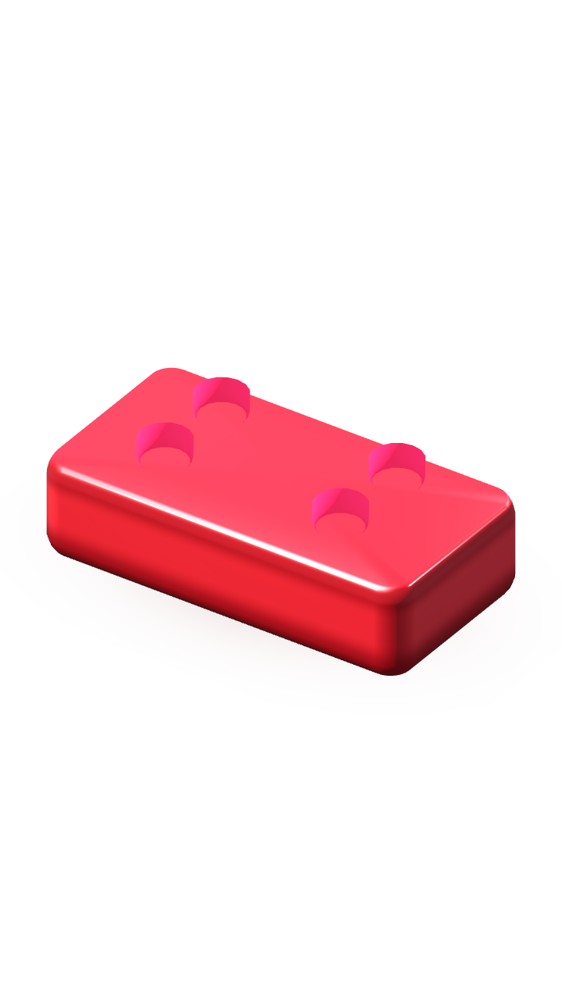
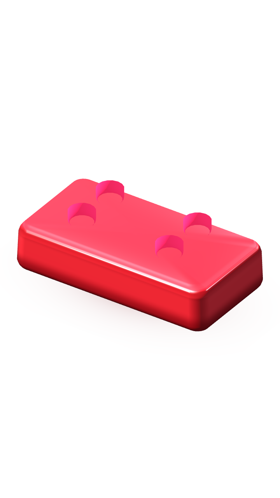

# Comparaison : original 2824.mp4 vs prototype isolé

**Source de vérité retrouvée et contrôlée le 22 octobre 2026 :**
[`reference-media/2824-original.mp4`](../../../reference-media/2824-original.mp4).
Taille 2 305 045 octets, SHA-256
`e7423f103b11678e2f2bbc8224562c67b3924079c7f262def81d90723b971ef4`.
Le validateur `scripts/verify-reference-media.py` a répondu PASS sur le binaire réel.

## Comparaison des formes

Le film original compare deux rendus l'un au-dessus de l'autre. La **moitié supérieure** est retenue comme référence artistique : couleurs vives bleu cobalt, rouge, vert et orange, corps gel glossy avec deux rangées de petits tenons, appuis doux, tours qui se déstabilisent et chutent.

### Écarts après cette itération

| Critère | Original | Prototype isolé | Verdict |
|---|---|---|---|
| Brique moulée | Rectangle épais, coins modérément arrondis | Même forme générale ; géométrie des triangles retournée dans la copie prototype | Progrès, contrôle de maillage à approfondir |
| Dessus | Dessus continu brillant, tenons lisibles | Dessus continu, liseré speculaire réel, quatre tenons teintés et raccourcis de 32 % pour correspondre aux proportions de la vidéo | Amélioration visible |
| Matière | Jelly lumineuse teintée, transmission dans l'épaisseur | Cœur opaque avec vernis séparé, proche du plastique brillant | **Échec du critère gel** |
| Contact | Pose et empilements physiques en cascade | Ombre pigmentée sous un objet, seul ; pas d'emboîtement entre pièces | Non validé |
| Rebond | Compression + déformation et propagation aux couches inférieures | Squash GPU local et oscillation analytique d'une brique | Prototype uniquement |
| Chute | Plusieurs briques chutent, rebondissent et s'entrechoquent | Une seule brique animée | Non validé |

Les images sont de **vraies captures GPU** Godot Compatibility, produites par `capture.gd` sur Mesa.
Les captures sont conservées dans le dépôt pour éviter de perdre les résultats entre sessions.

### Décision

La correction du culling et les tenons plus lumineux et courts sont conservés **dans le prototype**, sans migration au jeu.
La matière reste insuffisante. Prochain seuil : shader à transport de lumière contrôlé sans affichage de faces internes, contours déformables cohérents (tenons compris), et test d'empilement à au moins trois pièces. Ne pas publier le Play Store sur cette base.

Aucune image générée par IA n'est utilisée pour cette comparaison.
